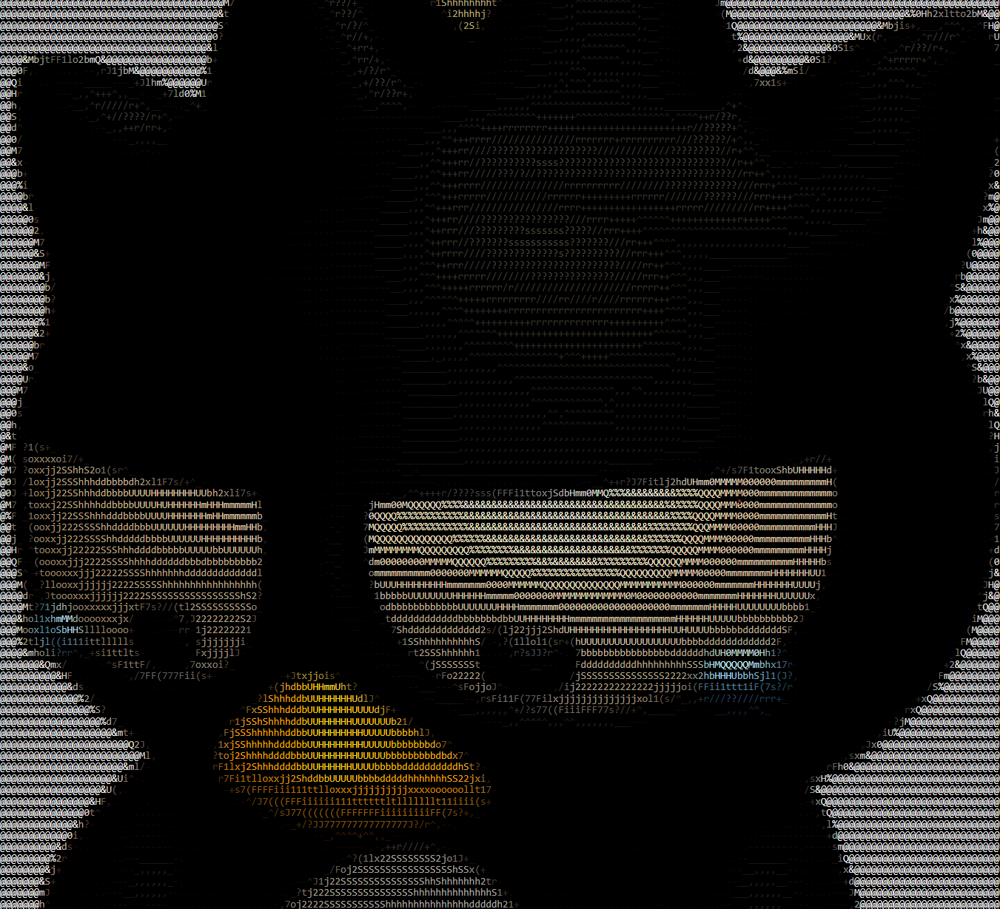
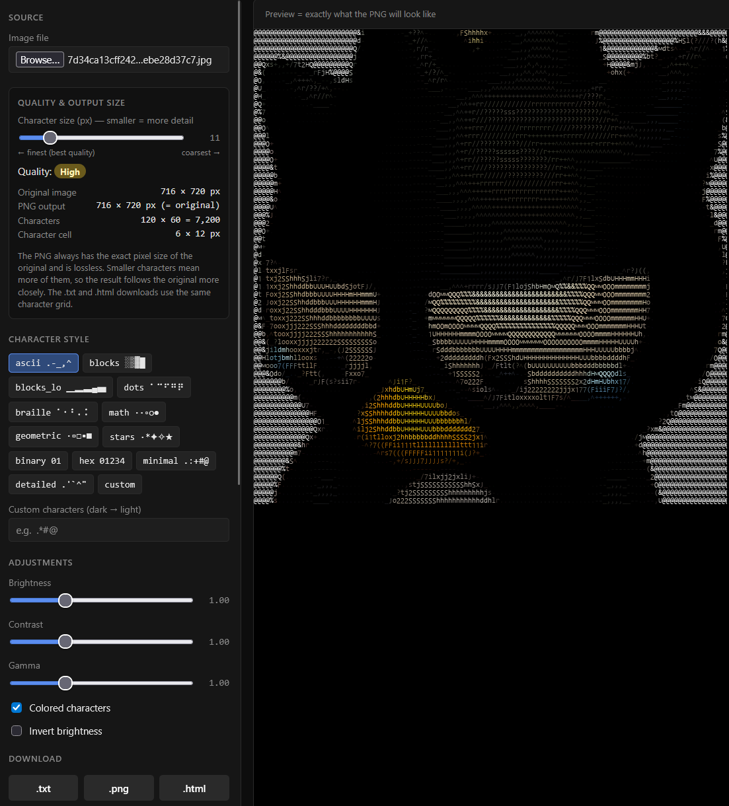
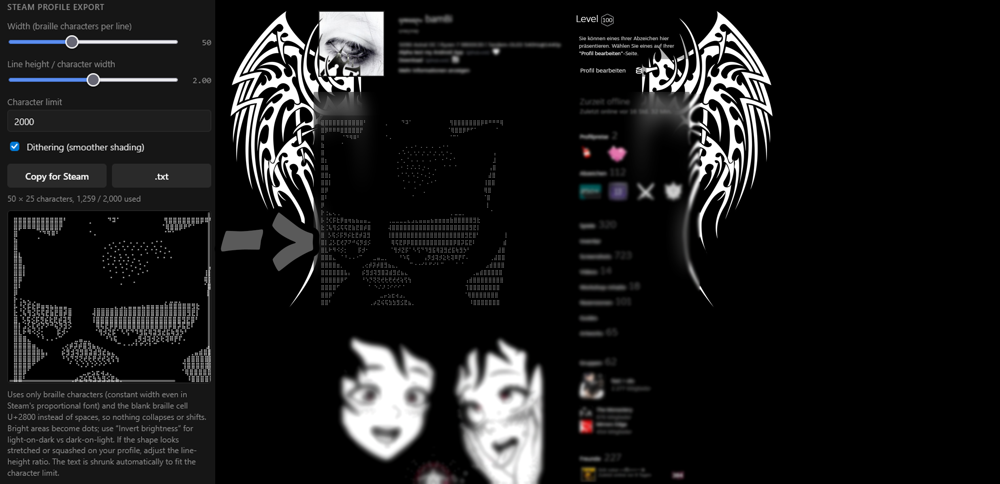

<div align="center">

# ASCIIFY

### Turn any image into living ASCII art - right from your browser.


</div>

---

## Showcase

Wallpaper in, ASCII out. Drop your own images into the `assets/` folder using the filenames below and they will show up here automatically.

<div align="center">

| Original Wallpaper | ASCII'fied Version |
|:------------------:|:------------------:|
|  |  |
| `assets/before.png` | `assets/after.png` |

</div>

---

## Features

- **Instant conversion** - upload an image and get ASCII art in seconds
- **Clean web interface** - runs locally in your browser, no accounts, no cloud
- **Steam ASCII-Art integration** - generate art ready for your Steam profile, comments and showcases
- **Lightweight** - just `asciify.py` and a tiny `requirements.txt`

---

## User Interface

The web UI is served locally by Flask and lets you upload an image, tweak the output and copy or save the result.

<div align="center">



<sub>`assets/ui.png` </sub>

</div>

---

## Steam ASCII-Art Integration

Asciify output is built to be pasted straight into Steam:

| Where | What you can do |
|-------|-----------------|
| **Profile summary** | Add an ASCII portrait or logo to your bio |
| **Comments & chat** | Drop in ASCII emotes and banners |
| **Artwork / Screenshot showcase** | Convert game screenshots into ASCII art |
| **Guides & Reviews** | Use ASCII headers to stand out |

<div align="center">



<sub>`assets/steam.png` </sub>

</div>

---

## Step-by-Step Guide

### 1. Clone the repository

```bash
git clone https://github.com/bamBi4k/asciify.git
cd asciify
```

### 2. (Optional) Create a virtual environment

```bash
python -m venv venv
venv\Scripts\activate        # Windows
source venv/bin/activate     # Linux / macOS
```

### 3. Install the requirements

```bash
pip install -r requirements.txt
```

### 4. Start the program

```bash
python asciify.py
```

You should see something like this:

```text
ASCII converter running at http://127.0.0.1:5000
WARNING: This is a development server. Do not use it in a production deployment.
         Use a production WSGI server instead.
 * Running on http://127.0.0.1:5000
Press CTRL+C to quit
```

> The warning is normal. Asciify is meant to run **locally** on your own machine, so the built-in Flask development server is perfectly fine.

### 5. Open the interface

Go to **http://127.0.0.1:5000** in your browser.

### 6. Convert your image

1. Upload your wallpaper / screenshot / picture
2. Adjust the settings if available
3. Click **Convert**
4. Copy the ASCII output or save it

### 7. Use it on Steam

Paste the result into your Steam profile, comments or showcase and enjoy.

### 8. Stop the server

Press `CTRL+C` in the terminal.

---

## Project Structure

```text
asciify/
|-- asciify.py          # Main application (Flask server + converter)
|-- requirements.txt    # Python dependencies
|-- assets/             # README images (before / after / ui / steam)
`-- README.md
```

---

## Troubleshooting

| Problem | Fix |
|---------|-----|
| `python` is not recognized | Install Python from python.org and tick **Add to PATH** |
| `pip install` fails | Run `python -m pip install --upgrade pip` and try again |
| Port 5000 already in use | Close the other app using it, or change the port in `asciify.py` |
| Page does not load | Make sure the terminal still shows `Running on http://127.0.0.1:5000` |

---

<div align="center">

Made by **bamBi4k**

If you like this project, drop a star on the repo!

</div>
